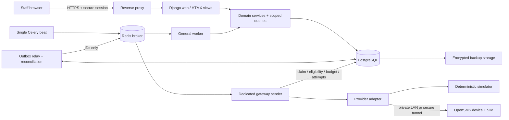

# Avanthi Attendance & Parent Alerts — architecture plan

Planning baseline: 8 November 2026. Intended implementer: **Gemini Argon**, as named by the project owner. Status: **architecture complete; application implementation not started**.

This package defines the application to build, the reasons for its structure, and the evidence required before declaring it complete. It does not claim a perfect architecture, production certification, or guaranteed SMS delivery. The owner's latest request authorizes planning only; implementation instructions inside the original attachment are deferred to the next model.

## 1. Read this package in order

| Document | Purpose |
|---|---|
| [Original product brief](docs/reference/ORIGINAL_PRODUCT_BRIEF.md) | Preserved owner requirements; its instruction to implement does not override this planning-only handoff |
| [This architecture](ARCHITECTURE.md) | Product boundary, system design, decisions, workflows, interfaces and UI |
| [Data model](docs/architecture/DATA_MODEL.md) | Entities, temporal rules, constraints, imports and attendance derivation |
| [Notification design](docs/architecture/NOTIFICATION_DESIGN.md) | Identity, state machine, transactions, gateway failures and duplicate prevention |
| [Verification and operations](docs/architecture/VERIFICATION_AND_OPERATIONS.md) | Security, deployment, live gates, recovery and requirement-to-test matrix |
| [Source review](docs/architecture/SOURCE_REVIEW.md) | Pinned OpenSMS review and primary technical references |
| [TASKS.md](TASKS.md) | Persistent implementation checklist; implementation boxes intentionally unchecked |
| [Gemini handoff](GEMINI_IMPLEMENTATION_PROMPT.md) | Ready-to-use instructions for the implementation model |

Workspace inspection found no existing source, dependency files, README, CLAUDE.md, TASKS.md or local AGENTS.md. The user supplied standing prompt-writing instructions in the chat. This plan therefore proposes a new application rather than implying existing components or commands were found.

## 2. Outcome and boundaries

Faculty record and explicitly finalize subject/period/lab attendance. The system determines each student's complete instructional day, then prepares at most one **automatic daily absence notice per student per designated normalized parent number**. It preserves both the decision and what was submitted. Staff can explain why a notice was blocked, accepted, failed or uncertain.

Use the title **Avanthi Attendance & Parent Alerts**, institute name **Avanthi Institute of Engineering and Technology**, and configured academic context **B.Tech | JNTUH**. These are owner inputs, not independently verified institutional claims. Use a text identity; addresses, campus code, departments, logo, official contacts and regulations remain configurable. No fictional institutional facts.

Include students/guardians, temporal enrollments, academic setup, timetables, attendance, imports, descriptive academic reports, notification operations, permissions, audit and recovery. Exclude fees, admissions processing, examination results, biometrics, facial recognition, parent login, marketing, multi-tenant billing, public registration and university scraping/integration. Do not add an ERP or a public API merely because the data could support one.

Daily notification policy and academic attendance policy are independent. Default daily policy is FULL_DAY_ABSENT. Academic thresholds, condonation and eligibility remain **Not configured** without an approved source. Never infer a JNTUH threshold or automatically label a student detained/ineligible.

## 3. Recommended system

Build a **modular Django monolith** with PostgreSQL as the source of truth, server-rendered HTML enhanced with HTMX, compiled Tailwind CSS, and Celery/Redis for background wake-ups. Use one repository and one application image across web and worker processes. OpenSMS remains an external device service behind a narrow adapter.



The boxes for services and adapters are code boundaries, not additional network services. The relay/reconciler can run as tasks in the general worker. Beat publishes reconciliation wake-ups after broker recovery; outbox records remain in PostgreSQL. A monitored management-command reconciliation path provides operator recovery if beat fails. No Redis-only notification state, result backend dependence, distributed saga platform or event-sourced academic database.

### Stack baseline

| Component | Decision | Reason / implementation constraint |
|---|---|---|
| Runtime | Python 3.13, latest compatible security patch | Conservative supported baseline; run in Linux containers |
| Web framework | Django 5.2 LTS, latest supported patch | Authentication, forms, ORM, migrations and long support window |
| Database | PostgreSQL 17, current supported patch; psycopg 3 | Transactions, row locks, conditional uniqueness and temporal constraints |
| Background jobs | Celery 5.7 compatible release + supported Redis release | Jobs are wake-ups; database decides whether work may execute |
| UI | Django templates, HTMX 2, Tailwind CSS 4 | Small client surface, usable HTML forms, shared server authorization |
| Authentication | Django sessions + django-allauth MFA | TOTP/recovery codes for privileged operators; no public signup |
| Phone parsing | Maintained Python libphonenumber port | Region-aware E.164 validation; never custom phone guessing |
| HTTP | Maintained synchronous client with retries disabled | Explicit connect/write/read handling, no redirects or implicit proxy use |
| Tests | pytest/pytest-django, real PostgreSQL/Redis/Celery integration, Playwright | Pure logic, concurrency, failure injection and browser evidence |
| Deployment | Docker Compose v2 on campus Linux host | Reproducible operational footprint; Windows development via Linux containers/WSL2 |

These are design baselines, not a generated lockfile. Resolve exact compatible versions and container digests at implementation, record provenance/licenses, and test the resolved set. Django 5.2 is an LTS and supports Python 3.13; PostgreSQL 17 meets its supported database floor. Celery documents task redelivery behavior that requires idempotent application handling. See the [source review](docs/architecture/SOURCE_REVIEW.md) for supporting primary documentation. Do not interpret a newer major release as a reason to change this stack without an actual need.

### Architectural decisions

| ID | Decision | Trade-off |
|---|---|---|
| ADR-01 | Modular monolith, no SPA/public REST API initially | Less duplicated validation and simpler deployment; page workflows remain the main interface |
| ADR-02 | Session attendance is authoritative; daily summary is derived | More precise than student/day records; requires explicit expected-session completeness |
| ADR-03 | Effective-dated academic records plus session/roster snapshots | More storage, but transfers and timetable edits cannot rewrite history silently |
| ADR-04 | Freeze a daily notification intent and recipient plan | Prevents edits creating a second automatic notice; changed contacts can require explicit review |
| ADR-05 | Database outbox and dispatch ledger; Redis is disposable transport | Additional tables, but outages and duplicate tasks cannot erase decisions |
| ADR-06 | Ambiguous dispatch suppresses automatic retry | Some notices may remain unsent; duplicate-risk avoidance takes priority over blind retries |
| ADR-07 | One sender per gateway with durable ownership | Limited hardware throughput; straightforward serialization and conservative failure recovery |
| ADR-08 | Campus LAN first; optional private tunnel for cloud | Requires local hardware operations; avoids exposing gateway HTTP publicly |
| ADR-09 | Separate simulation namespace and explicit live arm | Extra activation steps, but development results can never become real pending sends |
| ADR-10 | Runtime sender restart is disarmed until reviewed | Reduces automatic availability; materially strengthens restore and replay safety |
| ADR-11 | Android is the initial live capability target | Desktop/modem is supported only for capabilities proven by a separate device test, especially Unicode |

## 4. Code organization and ownership

Proposed layout below is a target for Gemini to create, not existing application code:

```text
config/                 settings, URLs, WSGI, Celery configuration
apps/accounts/          users, scoped grants, MFA integration, security audit
apps/institution/       institute settings, configuration revisions, activation checks
apps/academics/         programmes, branches, terms, offerings, enrollments
apps/people/            students, guardians, contacts, contact authorization
apps/scheduling/        calendar, timetable versions, daily plans and session rosters
apps/attendance/        registers, finalization, correction history, daily summaries
apps/notifications/     policies, intent/recipient plan, templates, outbox, attempts
apps/gateways/          simulator, OpenSMS adapter, gateway controls and budgets
apps/imports/           staged CSV preview, validation, transactional commit, exports
apps/reporting/         scoped dashboard and academic report queries
apps/audit/             append-only application audit and restricted access
templates/              shared layouts and feature templates/HTMX fragments
static_src/             Tailwind source and small local JavaScript modules
tests/                  unit, integration, concurrency, security, browser fixtures
deployment/             Compose, containers, proxy configuration, operator scripts
docs/                   architecture, setup, user guide, operations and evidence
```

Views/tasks call application services. Services validate permissions and invariants and own transactions. Scoped query functions apply read access. Models enforce local database invariants. External calls happen only in the gateway sender, after a committed attempt. Avoid opaque signal-driven business orchestration and calling `send_sms` directly from views, admin actions, imports or model methods. Django admin must call the same services or make protected models read-only.

Cross-module effects use explicit service calls for synchronous invariants and outbox events for derived work. The attendance mutation and its invalidation/outbox record commit together. Domain events contain stable IDs and revisions, not phone numbers or message text. Reports read authoritative records or versioned projections; cache misses never determine eligibility.

## 5. Main workflows

### Administrator onboarding

1. Create the first administrator through a local one-time bootstrap process with no default password; enroll MFA and secure recovery codes.
2. Confirm institute identity/campus, official contact, timezone and phone region. Defaults are Asia/Kolkata and IN, pending confirmation.
3. Configure real departments/branches, programme years/semesters, academic year and teaching terms, admission batches/regulations, sections, offerings and labs.
4. Publish calendar/timetable versions; validate overlaps, enrolled offerings without schedules, final period and notification window.
5. Import synthetic data in demonstration, or authorized operational data later; review guardians, contact authorization and faculty assignments.
6. Confirm daily policy and recipient policy; preview versioned English/Telugu messages and segment limits. Academic policy is a separate optional configuration with source/effective dates.
7. Run the entire workflow in simulator mode and review blocked/unknown cases.
8. Configure a private reachable gateway, secret reference, device capability profile and approved limits; complete non-sending diagnostics and the controlled test procedure.
9. An authorized administrator explicitly activates live mode for the current dispatcher generation and a stated earliest sending date. Never promote simulated rows or automatically replay earlier dates.

Missing operational inputs do not block software construction. Demonstration schedules and budgets must be labeled as examples and must not satisfy live readiness checks.

### Attendance and daily classification

Publish an expected-session plan before making daily absence decisions. A missing generated session is a gap, not evidence that no class was expected. Each student has a versioned expectation set derived from their effective enrollments, electives, lab group, timetable and exceptions. Completeness is evaluated per student, so an unrelated class cannot block them.

Faculty open an assigned session, inspect its frozen roster, mark explicit statuses, save drafts and finalize after reviewing totals. No automatic present/absent defaults. Finalization rejects expected UNMARKED entries and requires the session's actual scheduled end to have passed; an authorized officer may correct actual timings with an audit reason. A session is either unresolved, held, or explicitly cancelled/not conducted; zero expected students is flagged for review rather than silently treated as a valid register.

Optimistic row/session versions reject concurrent edits with a conflict response. Finalization rechecks versions under a database lock. Finalized changes require a correction service, permission and reason; no silent reopen-and-overwrite. Attendance history and the effective roster remain inspectable.

For FULL_DAY_ABSENT, classification requires a sealed expectation set, at least one held session, every expected session resolved, every held register finalized, and every held attendance record ABSENT. PRESENT, LATE or EXCUSED excludes; UNMARKED, unresolved or missing registers block. A cancelled session contributes neither absence nor held credit. Labs spanning periods count as one logical session by default; approved academic weighting is separate.

DailySummary stores attendance eligibility facts and reason codes, not just a boolean. Reasons include schedule unsealed, missing session, unfinalized register, no held sessions, non-absent status and inactive enrollment. Contact authorization, expired windows and gateway blockers are separate notification-layer reasons; attendance classification does not change when a phone goes offline or a window closes.

Alternative rules use all completed required attendance, an approved session/period basis, explicit excuse treatment, threshold and truthful partial-day wording. Never send one SMS per absent period.

### Notification and corrections

After notification time, reconciliation considers today's complete qualifying students. It builds a stable daily intent and deduplicated recipient plan, renders versioned messages, and writes notification rows plus outbox events in one transaction. A task only asks the sender to inspect database work. It is never authority to send.

The sender checks live authorization, date/window, latest academic/guardian revisions, pause state, recipient identity, template snapshot and shared budget immediately before creating the durable attempt and beginning the request. See the detailed [transaction protocol](docs/architecture/NOTIFICATION_DESIGN.md).

A correction synchronously marks affected summaries stale and invalidates pending work before its asynchronous recalculation. If the correction commits before dispatch authorization, the sender must block. After dispatch authorization, the UI warns cancellation is no longer guaranteed. Already submitted SMS cannot be retracted. Any correction SMS or historical/manual resend is a separate explicitly authorized action, disabled by default where specified.

## 6. Permissions and internal HTTP contract

Use capabilities attached to a role **and its own scope**, with validity intervals. Do not combine an unrelated broad scope with another grant's powerful capability. Scope applies to collection queries, individual object fetches, posted identifiers, exports, background jobs initiated by users, Django admin and HTMX fragments.

| Role | Default read scope | Default mutation capability |
|---|---|---|
| Institute administrator | Institute | Academic/student/user configuration and operations; sensitive actions require explicit capability and recent MFA |
| Principal / management | Institute summaries and reports | None; operational rights are explicit grants |
| HOD | Assigned department(s) | Review; corrections/approval only if specifically granted |
| Faculty | Effective assigned offering/section/session/lab group | Draft and finalize assigned sessions; correction only if separately granted |
| Class in-charge / mentor | Assigned section(s) | Review gaps/daily summaries; no implied contact reveal or sending permission |
| Attendance officer | Institute attendance and operational queues | Permitted corrections/exceptions; no automatic secret or live-activation rights |

Export, contact reveal, permission changes, gateway configuration, mode activation, manual sends/resends and schedule publication are separate capabilities. Contact data is masked by default; reveal and export are audited. Snapshot department/section ownership controls historical reports; faculty's current permission to perform a historical operation is checked separately from who originally taught it. Substitute assignments cover explicit sessions and time intervals; expiry prevents future actions unless a new grant authorizes historical corrections.

These are proposed browser routes, not a public API commitment:

| Route / method | Meaning and contract |
|---|---|
| GET `/dashboard/` | Scoped metrics with clear as-of time, timezone and mode |
| GET/POST `/students/`, `/students/{id}/` | Scoped list/create/edit; contact/history permissions separate |
| POST `/imports/preview/`; GET `/imports/{id}/` | Upload metadata/mapping and row errors; no live database mutation during preview |
| POST `/imports/{id}/commit/` | Requires confirmed mapping/revision, mode and request token; atomic, idempotent commit |
| GET `/attendance/sessions/{id}/` | Exact authorized frozen roster and current revision |
| POST `/attendance/sessions/{id}/draft/` | Explicit changed rows + base revision; all-or-nothing save |
| POST `/attendance/sessions/{id}/finalize/` | Base revision + request token; rejects unresolved records with field/row errors |
| POST `/attendance/sessions/{id}/corrections/` | Explicit diff + audit reason + base revision; scoped capability |
| GET `/attendance/daily/`; GET `/reports/attendance/` | Daily decision explanation and underlying subject records |
| GET `/notifications/`; GET `/notifications/{id}/` | Masked destination, snapshots, evidence and attempt history |
| POST `/notifications/{id}/manual-resend/` | Preview token, destination, duplicate-risk acknowledgement, reason and fresh permission check |
| POST `/operations/pause/`; POST `/gateways/{id}/pause/` | Idempotent audited stop controls; resume is a distinct action |
| POST `/gateways/{id}/diagnostics/` | Allowlisted non-sending checks only |
| POST `/gateways/{id}/test-message/` | Explicit preview and action; uses normal ledger/serialization/budgets |
| POST `/operations/live-activation/` | Configuration fingerprint + dispatcher generation + recent MFA; fail closed |
| GET `/health/live/`; GET `/health/ready/` | Sanitized process/DB checks; detailed operational status requires login |

All mutations use CSRF and server-side validation; no consequential GETs. Successful HTML forms use redirect-after-POST; HTMX receives validated fragments. Validation failures return a consistent 422 fragment/form contract; stale revisions return 409 with the current revision and conflict explanation. The client must explicitly handle those statuses. Use 403 or non-enumerating 404 for unauthorized operations. Request tokens are unique within action/actor/scope and bound to a payload hash: repeated identical requests return the prior result; token reuse with another payload fails. A UI idempotency token never replaces database notification uniqueness.

## 7. Interface specification

The interface should resemble a clear academic operations tool. Its main workspace is tables, registers and exception lists, with compact summaries above them. Avoid decorative gradients, glass effects, oversized hero headings and excessive pill/card layouts. This is an observable design choice for this app, not a general design ban.

Use a system sans-serif stack with Telugu-capable fallback; locally bundled fonts only if required. Base text 16px, secondary text at least 14px, page headings 24–28px. Use a 4px spacing scale with typical 16–24px panel gaps, 6–8px corner radii and subtle borders. Proposed tokens: canvas `#F8FAFC`, surface `#FFFFFF`, text `#0F172A`, muted text `#475569`, primary `#1D4ED8`, danger `#B91C1C`, warning text `#92400E`, success text `#166534`. Verify every rendered contrast pair; color is never the only status signal.

Desktop: compact navigation at left, persistent institute/mode/date header, content width suitable for registers. Mobile: collapsible navigation, full-width register with student identity and status control, sticky save/review actions that do not obscure focus. Responsive tables may scroll within labeled containers; the whole page must not overflow. Use 44px primary touch targets, visible focus, associated labels, semantic headings/tables, accessible dialogs, errors linked to fields, and keyboard alternatives to all actions. Respect reduced motion; avoid mandatory animation.

| Screen | Required connected behavior |
|---|---|
| Dashboard | Distinguish students absent, guardian notices, dispatch accepted, unknown, and estimated segments. Prioritize unfinished registers and blockers. Display timestamp and next scan; never fake connectivity or delivery |
| Students/guardians | Hall-ticket/name search, filters, temporal enrollment, contact authorization, masked values/reveal, import preview and scoped export |
| Attendance register | UNMARKED visible; explicit per-row status, search, keyboard navigation, save state, conflict recovery, bulk-mark confirmation, totals and explicit finalization |
| Daily detail | Expected/held/cancelled sessions, each attendance status, plan/revision and policy evaluation with blocking reasons |
| Academic reports | Counts and drill-down; policy-backed percentages only when configured; zero held denominator displays N/A |
| Notification list/detail | Filterable status/reason, policy, recipient mask, historical message, attempts, safe permitted actions and uncertainty explanation |
| Administration | Academic setup, assignment validity, timetable preview/publication, calendar, templates, mode/gateway, limits and audit |
| First-run wizard | Persist progress, distinguish example versus confirmed values, surface all live blockers; academic policy can remain unconfigured |

Offline UI must say that the latest edits are unsaved and retain them only in the current page memory where practical; do not put student rosters in localStorage or implement offline synchronization in v1. No silent success on network failure. Avoid HTMX history snapshots of personal records; use private/no-store responses for sensitive pages. Basic form submission should remain usable without HTMX where feasible.

Browser acceptance viewports: 360×800, 768×1024 and 1440×900, plus 200% zoom/reflow. Core workflows must work by keyboard; test focus after fragment replacement and validation. Target WCAG 2.2 AA with both automated and manual evidence.

## 8. Capacity and time semantics

Store instants in UTC; use explicit institute-local DateFields for attendance and budget dates. Snapshot the timezone used for each daily plan/window and intent. A timezone change takes effect on a future local day and must not reinterpret old dates. Recurring local windows are converted to explicit UTC boundaries for each date. Reject nonexistent DST local times; require an explicit fold choice for ambiguous times. Use a half-open sending interval `[opens_at, closes_at)`, within the same intended local day in v1.

Notification time must follow the actual final expected instructional end for the relevant scope; refuse dispatch while any expected session is in the future. Attendance cutoff is a missing-register review deadline, never an instruction to turn missing marks into absence. Late finalization within the open window is processed on the next reconciliation pass. Closing the window expires unsent work. Automatic scans never backfill previous dates after outages.

Proposed engineering test profile, not claimed institute size: 5,000 active students, up to eight logical sessions per instructional day, 100 concurrent staff sessions and 200 rows per register. This implies up to 40,000 attendance rows/day; retain/index according to the institute's approved history policy and measured database size. Start without partitioning; add it only after query/storage evidence justifies it.

Provisional performance acceptance on recorded reference hardware: p95 register load under 2 seconds, p95 draft save under 1 second, dashboard under 3 seconds, and newly eligible work visible within 120 seconds with a normal 60-second scan. Measure under the stated synthetic profile and disclose deviations. Gateway throughput is a separate measured constraint, never inferred from web performance.

Capacity preview computes expected recipients, rendered segment reservations and estimated drain time using measured safe pacing. If a batch cannot fit the window/budget, flag the shortfall before activation; do not raise limits or spill into the next day automatically. Initial one-gateway deployment is an intentional capacity boundary.

## 9. Inputs and risks left for the owner/operator

| Input or risk | Safe planning default | When required |
|---|---|---|
| Campus, departments/branches, official contact and branding | Text identity; labeled sample reference data | Before operational onboarding/live use |
| Actual academic structure, timetables, holidays and sending window | Configurable; no production schedule invented | Before publishing real daily plans/live activation |
| Authorized recipients, opt-outs and approved retention | Unconfirmed contacts are ineligible | Before real student disclosures |
| Daily rule and recipient policy | FULL_DAY_ABSENT; one designated guardian | Administrator confirmation before live |
| Academic rules and regulation evidence | Counts only; thresholds Not configured | Only before policy-backed academic percentages |
| Gateway hardware/network/SIM and approved limits | Simulator; no credentials or assumed allowance | Before live capability verification |
| Telugu text and modem Unicode compatibility | Draft language; Android target | Institutional language review and controlled hardware tests |
| Real size, host hardware, backup RPO/RTO and support ownership | Provisional test profile; operator sign-off pending | Before go-live |
| No idempotency/delivery API in OpenSMS | Unknown outcomes suppress retry | Permanent provider limitation unless a future adapter proves otherwise |
| Database restore or dispatcher restart | Disarmed; reconcile before reactivation | Every such operational event |

Routine implementation decisions may be made autonomously within this architecture. Pause for destructive real-data changes, unexpected public/API contracts, major architectural departures, paid purchases, public deployment, live student messaging, or unresolved safety invariants. Missing hardware is a live-validation limitation, not a reason to omit simulator functionality.

## 10. Completion boundary

Planning deliverables are these documents, the preserved brief, reviewed upstream contract and Gemini execution checklist. No runtime, schema migration, application scaffold, dependency installation, deployment or real SMS is part of this phase. Implementation completion must later be demonstrated against [all acceptance cases](docs/architecture/VERIFICATION_AND_OPERATIONS.md), with commands/results and limitations recorded; documentation alone is not application completion.
