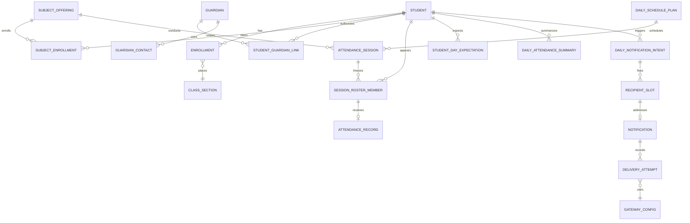

# Data model and attendance invariants

Status: proposed schema, not migrations. Read with [architecture](../../ARCHITECTURE.md) and [notification protocol](NOTIFICATION_DESIGN.md). Names may be refined during implementation while preserving the invariants and traceability.

## 1. Modeling conventions

Use UUID primary keys for durable identities and ordinary unique constraints for business keys. Every institute-owned root has an institute FK; this deployment has one institute, not a multi-tenant product. Validate all cross-entity institute relationships in domain services and with composite FK/constraint migrations where appropriate. UUIDs are not access controls.

Use timezone-aware UTC timestamps, explicit local dates, integer optimistic `revision` fields, and recorded actor/source for consequential changes. Effective date ranges are half-open `[start, end)`; open-ended ranges are allowed. Distinguish effective date from when an operator recorded the change. Active academic/context records cannot be hard-deleted when referenced by history. Cancellation/archival is explicit.

Use PostgreSQL exclusion constraints for non-overlapping date ranges where practical; document any required `btree_gist` extension. Service validation alone is insufficient under concurrent enrollment changes. Represent session/roster/policy versions as immutable evidence after use. Only projection rows such as DailyAttendanceSummary are replaceable, with their source revision recorded.

## 2. Entity groups

### Institution, academics and people

| Entity | Essential data and relationships | Main invariant |
|---|---|---|
| InstituteSettings / InstituteSettingsVersion | Name, campus ID, contact, short name, timezone, phone region, mode references | Singleton active institute; version changes are audited and future-effective where time-sensitive |
| Department | Institute, stable code, display name, active dates | Unique institute/code; historical labels retained |
| Programme | Institute, title, duration/year-semester structure | B.Tech years I–IV and I/II per year are defaults, not code-wide constants |
| Branch | Programme, department, code, title, active dates | Separate department from branch; effective department ownership if reorganized |
| AdmissionBatch | Admission cohort identity and entry year | Separate from current academic year and term |
| AcademicRegulation | Configurable code, source reference, effective applicability | No guessed JNTUH code or thresholds |
| AcademicYear | Label and bounded start/end dates | No implicit derivation from admission batch |
| Semester / TeachingTerm | Academic year, study year, semester ordinal, dates, programme | Separate recurring semester structure from the actual dated teaching term |
| ClassSection | Branch, teaching term, section code | Unique scoped code; never globally identify a section by name alone |
| LabGroup | Section/teaching scope, code | Membership is explicit and dated |
| Subject | Institute code, title | Reusable catalogue entry |
| SubjectOffering | Subject, term, teaching department, delivery type, sections, counting metadata | Electives/shared offerings can span sections; roster is not inferred from section alone |
| Student | Stable ID, hall-ticket string, name, archival status | Unique normalized hall-ticket within institute; never match by name |
| StudentIdentifierHistory | Student, prior hall-ticket/alias, validity and correction reason | Reserve current and historical normalized identifiers institute-wide to one student; do not recycle aliases across students in v1 |
| Enrollment | Student, admission batch, regulation, branch, term, section, effective range, status, entry/readmission event | At most one primary placement at a time; transfer/readmission creates a new interval |
| SubjectEnrollment | Student, offering, effective range, approved exemption metadata | No overlapping duplicate membership; electives independent of class placement |
| LabGroupMembership | Student, offering/group, effective range | No overlapping incompatible group assignment for the same offering |
| Guardian | Stable person/relationship identity and name | Never equate a person with a phone number |
| GuardianContact | Guardian, normalized E.164, validation/verification metadata and validity | Phone may be shared; do not globally uniquify it across people |
| StudentGuardianLink | Student, guardian, relationship, contact selection, designation/priority, effective dates | Multiple links allowed; default one designated eligible recipient |
| ContactAuthorization | Student/link/contact purpose, status, effective dates, evidence reference, reviewer, opt-out | Authorization is per student and disclosure purpose, not inherited across siblings |
| User / ScopedRoleGrant | User, capability-bearing role, institute/department/section/offering scope, validity | Evaluate each grant as one unit; deny by default |
| FacultyAssignment | User, offering, section/group/session scope, validity, substitution reason | Authorizes only explicit teaching scope; reject overlapping contradictory assignments |

Institutional history includes admission cohort and regulation applicability separately from present placement. A lateral entrant may have a configured admission-batch relationship and current year III enrollment without creating fictitious year I attendance. Readmission preserves earlier attempts/terms. Changes effective mid-day need explicit per-session roster corrections in v1; date-only enrollment intervals must not ambiguously split a teaching day.

### Timetable, calendar and attendance

| Entity | Essential data and relationships | Main invariant |
|---|---|---|
| AcademicCalendarDay | Date, scope, instructional/holiday flag, reason, override priority | Institute default with explicit branch/section exceptions; conflicting overrides cannot publish |
| TimetableVersion | Scope, effective range, status DRAFT/PUBLISHED/SUPERSEDED | Published history is immutable; changes create a new version |
| TimetableSlot | Version, weekday/rotation, start/end, offering, section/group, logical occurrence key, period spans | Multi-period lab is one logical occurrence with several period spans |
| ScheduleException | Date, affected slots/scope, extra/replacement/cancellation data, reason | Explicit replacement link prevents counting original and replacement twice |
| DailySchedulePlan | Local date, covered scope, source versions, revision, publication/seal status | Generation and coverage validation complete before sealing; never infer completeness from row count |
| StudentDayExpectation | Student/date, source plan versions, expected-set revision, sealed state | Covers all applicable offerings/calendars, including cross-section electives; one student's gap does not block unrelated students |
| AttendanceSession | Logical occurrence ID, offering, local date, start/end UTC, period spans, plan revision, HELD/CANCELLED/UNRESOLVED, register state | Unique occurrence per plan lineage; superseded instances do not coexist as active credit |
| SessionRosterMember | Session/student, enrollment IDs, historical section/group/department, expected flag, roster revision | One member/student/session; membership and exceptions are auditable |
| AttendanceRecord | Session/student, status, reason reference, version, last actor | Unique `(student_id, attendance_session_id)`; no student/day uniqueness here |
| AttendanceChange | Record/session revision, old/new value, reason, actor, recorded time | Append-only history for drafts/finalization/corrections as appropriate |
| AttendanceFinalization | Session/roster/register revisions, finalized actor/time and totals | Finalization identifies exactly which roster and values were approved |
| DailyAttendanceSummary | Student/local date, counts, decision, blockers, dirty flag, source fingerprint, computed time | Unique `(student_id, institute_local_date)`; stale projection never authorizes dispatch |
| AcademicAttendancePolicyVersion | Source/evidence, regulation/batch applicability, dates, weighting and status inclusion | Approved explicit configuration only; never reused as notification policy implicitly |

Attendance statuses are UNMARKED, PRESENT, ABSENT, LATE and EXCUSED. Store leave/on-duty reason separately from status; avoid free-text sensitive reasons in SMS. Track attendance register lifecycle DRAFT/FINALIZED separately from whether the class was held. An unresolved or unfinalized class must not be converted to cancelled automatically at cutoff.

### Notifications and operations

| Entity | Essential data | Main invariant |
|---|---|---|
| NotificationPolicyVersion | Rule, basis, threshold/excuse behavior, recipient policy, time window, effective scope | Immutable after use; same-day policy edits invalidate unsent decisions but do not create a second intent |
| MessageTemplateVersion | Rule compatibility, language, literal template, allowlisted placeholders, approval | No general-purpose template evaluation; partial-day rule cannot select full-day wording |
| SimulationRun | Synthetic/sandbox run identity, scenario seed and mode | Cannot be promoted into live ledger |
| DailyNotificationIntent | Namespace, institute, student, date, kind, plan/policy revision, freeze markers | Unique business day identity independent of phone/template/schedule edits |
| RecipientSlot | Intent, stable slot ID, initial guardian/link IDs, frozen destination | Slot identity remains stable across edits; recipient set freezes when first queued |
| Notification | Intent/slot, immutable dedup destination key, status, reasons, current payload revision | Unique intent/destination and intent/slot; accepted/unknown automatic work never reopens |
| NotificationPayloadVersion | Rendered text, exact destination, source contact/authorization, template/policy, language, estimator version | Immutable per attempt; distinguish current contact from historic destination |
| DeliveryAttempt | Optional notification, optional manual authorization, attempt number, request ID, purpose/mode, generation, gateway, phase/outcome, timings, evidence, immutable payload | Must have notification or manual authorization; automatic requires notification, every manual requires authorization. Persist before HTTP; conditional unique active attempt per notification |
| ManualSendAuthorization | Action ID, purpose, optional student/date/original intent/attempt, exact destination/message/segments, preview hash, reason, actor, MFA time, expiry | Unique one-use approval; can represent a test without a student. Exactly one physical attempt per approval; another manual attempt needs a new approval |
| DestinationDispatchGuard | Namespace, institute, student/date/disclosure family/destination key, or standalone test authorization/destination key, active/submitted evidence | Lock actual payload destination for automatic and manual actions; retargeting cannot bypass another slot's pending/submitted suppression |
| GatewayConfig / GatewayRuntime | Allowlisted endpoint, secret reference, capability profile, pause, active attempt ID, generation | Never store raw key in ordinary settings; one active HTTP attempt per gateway |
| GatewayBudgetDay / SegmentLedger | Gateway/local date, limit, reserved/consumed values, attempt entries | Atomic shared budget; unknown consumption remains reserved/consumed conservatively |
| OutboxEvent | Event UUID, aggregate/revision/type, created/due/published timestamps, retry bookkeeping | Unique semantic event key; publication is at least once |
| DispatchControl / ActivationRecord | Global pause, config fingerprint, runtime generation, approved earliest date, actor | Database flags alone cannot enable live after a restart/restore |
| ImportJob / ImportRow | File hash, mapping, target scope, explicit mode, base revisions, preview status/errors | Retrying the same committed import cannot repeat mutations |
| AuditEvent | Actor/service identity, action, object IDs, restricted diff, reason, timestamp, correlation ID | Application role cannot edit/delete normal audit history |

The exact recipient edit rules and database uniqueness keys are specified in [notification design](NOTIFICATION_DESIGN.md). Keep daily intent kind separate from dispatch purpose. Test/historical/correction actions require purpose-specific ManualSendAuthorization; tests need no fabricated student/day intent. A manual resend may reference the original notification and authorization together. Guard the same student's absence disclosure/date/destination across automatic and manual absence purposes; changing purpose never bypasses suppression.

## 3. Relationship view

This diagram is a navigation aid, not the full FK specification. Membership/version linkage is explicit even when omitted from the diagram.

## 4. Expected-session construction and qualification

1. Resolve the student's effective active placement, subject enrollments and lab memberships for the local date.
2. Resolve published calendar and timetable coverage for every relevant offering; missing coverage blocks sealing, even when no sessions have been generated.
3. Expand recurrence/rotation slots and approved extra/replacement exceptions into stable logical sessions. Deduplicate period spans of one lab occurrence; never collapse genuinely separate lectures merely because subject/date match.
4. Freeze expected roster and source identifiers. Validate conflicting time overlaps; an approved overlap exception must state the intended student-specific participation, not expect one student in two places.
5. Seal the student's expectation set only when all applicable schedule sources have been published and generation is complete. A fully specified no-class day can be sealed with zero held sessions, producing NO_HELD_SESSIONS rather than absence.
6. Resolve each expected session as held or cancelled with an authorized reason. A held session requires a finalized register. A cancelled one requires no fabricated marks.
7. Compute counts and policy decision from the sealed set and latest finalized revisions. Store dependency fingerprint and concrete blockers.

Let H be held logical sessions, U unresolved required sessions/registers, and A/P/L/E their explicit attendance counts. For FULL_DAY_ABSENT: `sealed AND active AND H > 0 AND U = 0 AND A = H`. Any UNMARKED or missing expected record contributes to U. Any PRESENT, LATE or EXCUSED makes `A = H` false. This logic does not include contact or gateway availability.

For ANY_SESSION_ABSENT: require the same completeness and H > 0, then at least one counted ABSENT. For ABSENT_SESSION_THRESHOLD: require approved threshold and basis, then compare counted absences. The alternative policy explicitly declares excuse handling and denominators. Both use partial-day wording with matching units. Unsupported or contradictory policy settings fail publication rather than falling back silently.

Revisions to attendance, enrollment, roster, session cancellation, extra classes, timetable, calendar or policy must synchronously mark affected student-days dirty and invalidate unsent payload eligibility in the same transaction. Large changes put the affected plan scope into an invalid state before batch recomputation. Sender reads the scope revision as well as individual summary revision, closing the asynchronous gap. New extra classes after any dispatch are prominently flagged as post-dispatch corrections.

Finalized register edits are all-or-nothing under a session lock. Record and roster revisions prevent a concurrent finalization from succeeding against stale data. Membership changes do not delete historic attendance; replace effective snapshots with an auditable revision and recompute dependent summaries/reports.

## 5. Constraints and indexing to implement

Required constraints: unique institute-wide identifier registry spanning current/historical hall-tickets; unique student/session attendance; unique student/date summary and expectation; unique logical session occurrence in active plan lineage; non-overlapping primary enrollment and subject/group memberships; start before end for intervals; nonnegative segment counts; valid status/rule enum values; positive threshold where used; one active attempt per notification; one active attempt per gateway; unique intent and actual-destination guard keys; unique consumed manual authorization. StudentIdentifierHistory can serve as the registry if current identifiers are registered there too; never enforce uniqueness in two unrelated tables only.

Key indexes: session `(institute, local_date, section, offering, state)`; roster `(student, session)`; enrollment/assignment ranges and scope; summary `(local_date, dirty, decision)`; notification `(status, next_attempt_at, closes_at)` with partial active-work index; intent `(student, attendance_date)`; outbox unpublished/due index; attempt `(notification, created_at)`; scoped audit `(object_type, object_id, created_at)`; name/hall-ticket search selected from measured query plans. Avoid indexing full message text or raw phone values for analytics.

Foreign keys protecting attendance, attempts and audit evidence should normally restrict destructive deletion. A dedicated retention procedure handles permitted redaction/erasure and audit consequences; `CASCADE` is not a convenient student-delete policy.

## 6. Import and export contracts

Student CSV columns: `hall_ticket_number, student_name, admission_batch, academic_regulation, department_code, branch_code, study_year, semester, section, lab_group, guardian_name, guardian_relationship, guardian_phone, notification_preference, enrollment_status`.

Required mappings include hall-ticket/name and enough explicit academic context to resolve a unique placement. An operator may supply batch/term/section as a preview-level default, but it must be displayed on every affected row and confirmed. Missing regulation remains unconfigured; missing lab group is acceptable only when no selected subject requires it. Missing guardian/invalid phone is a reviewable contact warning: the student/enrollment may import with that contact quarantined and sending disabled, after explicit warning acknowledgement. Invalid student identity, ambiguous matches or academic references are blocking row errors. Missing preference defaults to not authorized for sending. Enrollment status requires an explicit row value or confirmed import default. Hall-ticket validation is administrator-configured; use no invented university regex.

Imports use `CREATE_ONLY`, `UPDATE_ONLY` or explicitly confirmed `UPSERT`. Identity matching is by stable student ID when provided, otherwise the unique configured hall-ticket/verified identifier registry. Reject conflicting or multiply matched legacy aliases; never choose the first match or infer identity from a name. Guardian deduplication cannot assume identical phone equals identical person; preview ambiguous relationships. Phone strings remain strings, retain `+`, and normalize through the chosen library. Parsing success is distinct from contact authorization and proof that the recipient currently controls the number.

Workflow: upload into restricted temporary storage → enforce configurable byte/row limits and CSV encoding/header checks → map columns → validate every row and references → show create/update diffs, blocking errors and contact warnings separately → explicit confirmation/acknowledgement → revalidate scope/current revisions → atomic commit and audit → expire/delete raw file according to policy. Reject the commit if reference data changed since preview. V1 commits all rows in one transaction only when no blocking errors remain, including acknowledged quarantined contacts; no silently partial batches. Large files above the limit are rejected with guidance rather than partially imported.

Persist import job UUID and content/mapping/mode/target hash. Repeated confirmation of a committed job returns its existing result. Reuploading the same file detects earlier processing; updating an already imported record still requires an explicit new reviewed job. Inside one file, duplicate hall-tickets/conflicting contacts are row-level errors, not last-row-wins.

Attendance import uses `attendance_date, attendance_session_id, hall_ticket_number, status, reason_code`; a human-readable subject/period alias is allowed only if it resolves uniquely in preview. Subject/date alone is ambiguous when several sessions exist. Validate frozen roster membership and marking permission; imported records remain draft. Finalization still follows the normal faculty workflow. Already-finalized imports require the correction path, never overwrite.

CSV exports use proper quoting plus spreadsheet-formula neutralization for dangerous prefixes after leading whitespace/control characters (`=`, `+`, `-`, `@`, tab/CR/LF). Treat hall-tickets and phones as text and document spreadsheet display behavior. Provide a documented safe reimport path for any export escaping, without stripping arbitrary leading characters from unrelated imported data. Audit scoped exports and deliver them through authenticated expiring download routes; no public URLs.

## 7. Academic reporting

Counts always show the underlying held sessions and explicit status categories. Without an approved AcademicAttendancePolicyVersion, display counts and `Policy not configured`; do not invent an official percentage. With a policy, select it by regulation/batch/effective dates and calculate transparent numerator/denominator using its held/scheduled basis, weights, labs, exemptions and enrollment intervals. If policy versions or incompatible counting units cross the selected range, show separate groups instead of averaging percentages arbitrarily.

Display zero denominator as N/A. Drill down to every included/excluded session and reason. Reports are institute operational reports, not official JNTUH submissions or exam eligibility decisions. Exports honor the same object scope and historical enrollment context as the screen.
