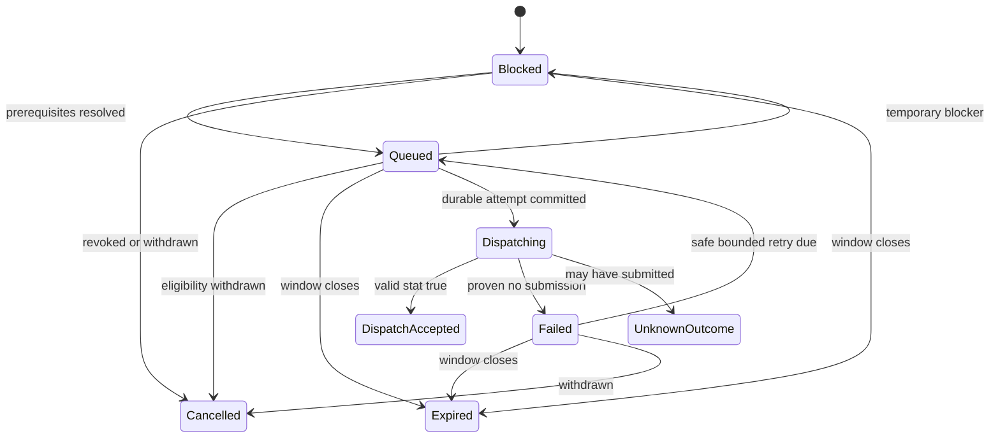

# Notification identity, dispatch protocol and failure recovery

This is a behavioral specification for Gemini, not implemented code. PostgreSQL is authoritative. Celery tasks are wake-ups. The gateway contract was reviewed at OpenSMS commit `810c20de0e512bd0e92094d550a6ddef58a6e286`; see [source review](SOURCE_REVIEW.md).

## 1. Guarantees and limits

The application must prevent duplicate automatic business notifications under repeated scans, requests and task deliveries. It must not claim exactly-once physical SMS or recipient delivery. A committed local transaction and an external device call cannot be one atomic operation. When submission may have happened, stop automatic retries and preserve uncertainty.

Primary safety invariant: **one automatic daily intent per student/date/kind, one recipient record per normalized destination in its frozen plan, and no further automatic dispatch for a recipient after an accepted or potentially submitted attempt**. An explicit manual resend is an auditable exception with duplicate risk, not a new automatic daily notice.

## 2. Stable business identity

Use the following keys:

| Record | Database uniqueness |
|---|---|
| DailyNotificationIntent | `(namespace_id, institute_id, student_id, attendance_local_date, kind)` |
| RecipientSlot | `(intent_id, stable_slot_key)` |
| Notification | `(intent_id, recipient_slot_id)` and `(intent_id, normalized_destination_key)` |
| DeliveryAttempt | `(notification_id, attempt_number)`; conditional unique active attempt |
| ManualSendAuthorization | Unique action/request token with immutable preview hash |
| DestinationDispatchGuard | Unique live/simulation namespace + institute + student + original attendance date + disclosure family + **actual payload destination**; standalone tests instead use authorization ID + destination |

For live data, namespace is the installation's fixed LIVE namespace. **Dispatcher generation, retry number, template, policy version, contact version and settings revision are never part of the live deduplication key.** SimulationRun namespaces are separate, and rows cannot change namespaces or be promoted to live. Development/test should additionally use isolated databases and lack gateway credentials/network access.

Normalized destination keys may use a protected deterministic HMAC if contact encryption is adopted. Keep normalization/HMAC versions stable across rotations or migrate them atomically without losing uniqueness. A random ciphertext cannot enforce destination deduplication. Plain normalized values in a restricted encrypted-at-rest database are a simpler acceptable initial choice; mask access and avoid ordinary logs.

Create an intent when a student's day qualifies, including an intent-level BLOCKED result if no eligible contact exists. Do not create one notification for every non-absent student. Once recipients are first queued, freeze the selected guardian/link IDs, stable slots and deduplicated normalized numbers. Duplicate links to the same number for one student produce one slot; siblings produce separate intents and separate messages.

Rules for later changes:

| Change | Automatic behavior |
|---|---|
| Missing contact fixed before recipient plan is frozen | Re-evaluate authorization and build the first valid plan |
| Phone changed after queueing | Cancel that unsent slot; no automatic retarget to the new number. Offer an explicitly reviewed manual replacement if appropriate |
| New guardian added or designation changed after freeze | Do not append recipients silently; show plan/current-contact difference for review |
| Contact authorization revoked or student archived | Cancel all affected unstarted slots immediately; mark any started attempt as cancellation-not-guaranteed |
| Template edited | Preserve queued template version unless an authorized pre-dispatch rerender explicitly replaces the payload version; never create new intent |
| Attendance/schedule/policy changes | Invalidate eligibility synchronously; update/cancel existing work, never change identity |
| Corrected student qualifies again after cancellation | Reuse intent/slot; reopening requires explicit review and proof no possible submission. No automatic resurrection of a manual cancellation |
| Accepted or unknown outcome, then any edit | Keep suppression and history. Any further send needs a separate explicit authorization |

This intentionally favors safety over automatic retargeting. A manually approved replacement is linked to the original intent, visibly classified as manual, checked against prior destination attempts and included in budgets/audit. It cannot be disguised by changing notification kind.

Every attempt also locks DestinationDispatchGuard for the **actual** payload destination. Automatic absence, historical absence and manual absence resend/replacement share the ABSENCE disclosure family for the same student/original date. If a replacement destination already belongs to another queued slot, reject the replacement and direct the operator to that slot; do not allow two independently active records. If that destination has any possibly submitted attempt, only an explicit duplicate-risk resend authorization can proceed, and automatic work stays suppressed. A genuinely distinct correction uses CORRECTION family only through the explicit correction permission/workflow and links the original notice. Changing an enum alone never grants this exception.

Freeze the exact message, destination, authorization evidence, language, segment estimate/estimator version, policy and template versions into NotificationPayloadVersion. Every attempt points to that immutable version. Current profile details must never replace historical evidence in an attempt detail view.

## 3. States and actions

| Status | Meaning and automatic action |
|---|---|
| BLOCKED | An actionable prerequisite is missing. Store reason, responsibility and last evaluation. Recheck while date/window remains valid |
| QUEUED | Eligible pending work, not permission to bypass a fresh pre-call check |
| DISPATCHING | Durable attempt exists; cancellation cannot be guaranteed; no other task may submit it |
| DISPATCH_ACCEPTED | Valid gateway acceptance evidence only. Terminal for automatic dispatch |
| FAILED | Proven no dispatch; distinguish retry-safe transient failure from operator-fix-required rejection |
| UNKNOWN_OUTCOME | Submission may have occurred; automatic retry prohibited. Keep risk/evidence and any gateway quarantine |
| CANCELLED | Pending work withdrawn. Remains historical; guarded reviewed reopening can reuse identity only when no possible submission exists |
| EXPIRED | Sending window or intended date passed. Never automatically reopen on another day |

Intent status can aggregate multiple recipient statuses; do not call the intent accepted merely because one of several recipients was accepted. Notifications with invalid/missing destinations remain intent-level blockers until a valid slot exists. Each recipient has its own attempt history.

Manual resends add a ManualSendAuthorization and a new attempt; they never erase the original accepted/unknown result. Show original status plus subsequent manual activity/outcome. A ManualSendAuthorization contains purpose, one-use request token, immutable exact destination/text/segments, actor/recent MFA, preview hash, reason, expiry, and optional student/date/original notification links. Every manual attempt requires one such approval, including a test with no student. DeliveryAttempt therefore has nullable notification and manual-authorization links with constraints requiring at least one, a notification for automatic attempts and authorization for manual attempts. One manual authorization funds one attempt; any manual retry requires a fresh reviewed authorization. All attempts use the same sender, runtime controls and budget.

Corrections and historical sends use explicit purposes and truthful wording/original attendance date, disabled by default until granted. A test is recorded under its authorization identity without a fake DailyNotificationIntent. Reserve DELIVERED for a future provider with actual delivery evidence; never show it for OpenSMS or simulator results.

## 4. Outbox, invalidation and reconciliation

Within the attendance/configuration transaction, write the mutation, audit record, source revision, affected summary invalidation and outbox event. For scope-wide changes, mark the scope invalid before chunked recalculation; all affected senders check the scope guard. An `on_commit` enqueue may improve latency but is not durable by itself.

The outbox relay claims due rows using short transactions and `FOR UPDATE SKIP LOCKED`, publishes IDs/revisions, then records publication. A relay crash between publish and acknowledgment causes duplicate publication, which is expected. Claim leases can safely expire for publication because duplicate wake-ups cannot independently send.

Periodic reconciliation scans the database for stale projections, unpublished events, today's eligible unqueued work, due QUEUED/known-safe FAILED records, expired windows and stale attempts. It must also republish published-but-still-pending work: Redis can lose an already-published message. `published_at` is not proof that work was executed.

Use one ordinary beat instance and short interval wake-ups, initially 60 seconds. A separate reconciler heartbeat/alarm detects scheduler failure. Initial execution scans the current institute-local date only. Past records expire or go to review; do not backfill earlier days automatically. Scope-based batching permits complete students to proceed independently of other sections.

## 5. Locking and dispatch transaction boundaries

Use one dedicated Celery sender consumer per physical gateway, concurrency one and prefetch one. A PostgreSQL session advisory lock is an additional cross-process guard, held on a dedicated non-pooled connection from preparation through result recording. A durable GatewayRuntime.active_attempt_id is required as well: release/loss of a session lock is not proof an external call has ended. No dispatch takeover based solely on lease age.

All services use one documented row-lock order when they touch the same records: **DispatchControl → GatewayRuntime → configuration/schedule scope guards sorted by ID → session rows sorted by ID → student/day coordination rows sorted by ID → intent → notification → manual authorization → actual-destination guards sorted by key → budget rows sorted by ID → attempt**. A path that skips an earlier category must never acquire it later. Attendance, finalization, cancellation, roster/materialization and enrollment mutations all acquire relevant scope guards before session rows; projection builders use the same guards. Dispatch need not lock session rows because source mutations synchronize through the shared guards. Do not introduce an inverse path through Django admin, bulk updates or imports.

The student/day coordination row can be the guaranteed-existing DailyAttendanceSummary row. Initialize with unique upsert/retry before locking, and treat it as dirty until computation completes. Configuration changes that affect many students acquire their scope guard, mark its revision invalid, then schedule expansion. Small transactions and deterministic lock ordering reduce deadlocks; bounded database deadlock retries are allowed **before** dispatch preparation commits, never as a wrapper around HTTP.

### Transaction A — source mutation

1. Authorize actor against current capability/scope and expected revision.
2. Acquire relevant locks; change attendance/roster/contact/configuration.
3. Increment source guards, mark summaries dirty, cancel or invalidate unstarted work, and record any post-dispatch correction warning.
4. Insert restricted audit event and outbox event; commit together.

### Transaction B — authorize one attempt

1. Acquire gateway advisory lock and verify no active/quarantined attempt. Verify current dispatcher generation is armed outside restored database state.
2. Lock database controls/guards/summary/intent/notification/budget in the specified order.
3. Read authoritative current time and determine purpose from a validated workflow, never an arbitrary posted kind. For automatic absence require matching local attendance date, configured instructional day, active enrollment, sealed/current expectation set, finalized held attendance, qualifying policy and no future expected session. Apply the purpose-specific table below to manual work.
4. Require the appropriate current recipient authorization/preference and frozen-destination validity; check global/per-gateway pause, approved gateway/secret profile, intended mode and current generation. Lock/check the actual-destination guard; prior possible submission suppresses automatic work regardless of which notification recorded it.
5. Recheck applicable summary/payload/policy/template revisions and manual preview freshness. If a required summary is dirty, leave blocked and trigger recomputation; do not send from stale cached facts. Validate the purpose's current sending window/approval expiry and pacing. Automatic absence additionally requires its earliest allowed attendance date.
6. Reserve configured segments atomically; reject/hold if cap or per-message limit would be exceeded. Set budget date using the configured institute timezone in v1; one shared budget applies to every use of this gateway.
7. Insert DeliveryAttempt, set DISPATCHING, bind gateway active attempt, record generation and request deadline, and commit.

Purpose-specific checks are additional to the common safety gates; manual mode is not a blanket bypass:

| Purpose | Specific eligibility |
|---|---|
| AUTOMATIC_DAILY_ABSENCE | All original daily eligibility conditions, today's date, automatic window and earliest automatic date; no manual authorization can weaken them |
| TEST | Explicit TEST capability, owned/authorized test destination, exact preview, one-use fresh approval and configured operator test window; no student/attendance condition |
| MANUAL_ABSENCE_RESEND / REPLACEMENT | Original student/date/context, current authorized destination, current verified absence summary, explicit reason/preview and duplicate-risk acknowledgement where applicable; no active conflicting destination attempt; current approved manual sending window |
| HISTORICAL_ABSENCE | Explicit historical-send capability/reason, complete current recomputation for the original instructional date, truthful original date in text, current recipient disclosure authorization, fresh one-use approval and current manual window; never scheduler-created |
| CORRECTION | Explicit correction capability and enabled feature, linked prior notice, verified corrected facts, accurate correction wording, current recipient authorization, fresh one-use approval and current manual window; it need not still qualify as absent |

Manual/test windows are separately configured allowed **sending times now**, not permission to send late automatically. Missing or ambiguous policy blocks the manual action. Student enrollment/authorization checks use the appropriate historical attendance context and current disclosure permission rather than requiring a historical student to be currently active in that old term. An operator cannot resolve a live-arm or pause failure with a manual authorization.

### External call — outside SQL transaction

Check the runtime emergency stop/generation immediately before transport invocation. If an explicit stop is observed and this live process can prove the transport was never invoked, record a known pre-call cancellation/failure. Otherwise make **one** HTTP invocation for this attempt. Disable automatic retries and redirects at every HTTP/proxy layer; use finite connect/write/read and total deadlines. Do not hold a SQL transaction during the call.

No check eliminates the small interval between authorization and device submission. Transaction B commit is the advertised cancellation boundary. A correction/pause that commits afterward may be too late; disclose that even if it precedes the physical call by milliseconds.

### Transaction C — record evidence

1. Reacquire short row locks in the common order; verify attempt/generation ownership.
2. Persist classified outcome, redacted diagnostic code, timings and response validation evidence. Do not store secrets or arbitrary response bodies in ordinary logs.
3. Accepted/unknown attempts consume or retain their segment allocation. Proven no-submission attempts release it once; enforce ledger uniqueness against repeated callbacks/results.
4. Update notification and gateway pacing/runtime state, audit and operational outbox. Clear active attempt only after the request has ended with known ownership. Unknown overlap risk quarantines the gateway.

If persistence fails after an HTTP result, never invoke HTTP again. The attempt remains DISPATCHING and recovery classifies it UNKNOWN. Database loss or advisory-lock loss during the call pauses/quarantines the gateway until the previous process/request is known to have ended. A potentially still-running sender must be terminated or fenced from the network before another sender can be armed. Application locks cannot control another application or a person independently sending from the same SIM; document the gateway's dedicated-use assumption.

## 6. Provider adapter contract and failure classification

Internal operations: `dispatch(immutable_attempt_payload) -> classified evidence`, `diagnose_without_sending() -> limited diagnostics`, and a capability descriptor. These are conceptual interfaces, not claims of upstream APIs. No provider health, status lookup, message ID, idempotency key, callback or bulk-send feature is assumed.

OpenSMS wire contract: backend-only POST `/sms/`, bearer secret, JSON `number` and `text`, normally port 9292. Require a successful expected response with JSON object whose `stat` is a real boolean; strings/numbers/null are invalid. Valid `stat=true` maps to DISPATCH_ACCEPTED, not handset delivery. No browser access to gateway credentials. [Reviewed API source](https://github.com/daslearning-org/OpenSMS/blob/810c20de0e512bd0e92094d550a6ddef58a6e286/app/services/postApi.py)

| Observation | Classification | Automatic retry |
|---|---|---|
| Local invalid payload, unauthorized endpoint or absent secret before invocation | BLOCKED / configuration failure | No; fix configuration |
| DNS resolution failure or connection refused, transport positively proves no submission | FAILED / transient pre-submit | Bounded backoff if still eligible |
| Connect-stage timeout proven to precede any application request | FAILED / pre-submit | Bounded retry only with that evidence; otherwise UNKNOWN |
| Auth/validation rejection conclusively from the reviewed upstream pre-send path, such as its 401 or invalid-number 400 | FAILED / rejected before send | Operator fix; no repeated automatic authentication spam |
| Unexpected 4xx/5xx, proxy error or untrusted response origin | UNKNOWN unless a reviewed contract proves no send | No blind retry |
| HTTP success with strict boolean `stat=true` | DISPATCH_ACCEPTED | Never |
| HTTP success with `stat=false` | UNKNOWN with provider-reported-failure reason unless capability-specific evidence proves pre-submit failure | Never by default |
| Read timeout, partial write, reset/lost connection after possible submission | UNKNOWN | Never |
| Malformed JSON, missing/wrong-type `stat`, oversized response, unexpected redirect | UNKNOWN after possible submission | Never; do not follow redirect |
| Worker death or stale DISPATCHING, including crash before actual HTTP | UNKNOWN | Never |

Why `stat=false` is conservative: the provider's boolean does not distinguish all failure phases. The desktop path can submit data before deciding whether the modem response establishes success. That is insufficient evidence that a failed result means no SMS was submitted. [Reviewed modem code](https://github.com/daslearning-org/OpenSMS/blob/810c20de0e512bd0e92094d550a6ddef58a6e286/app/services/serialMgr.py)

Do not classify generic `ConnectionError` or HTTP 500 as safely retryable. Keep transport-stage evidence explicit and unit-test its mapping. Known-safe retries use database `next_attempt_at`, bounded attempts and jitter; starter values may be simulator examples but must be configurable. Only retry when the next due time still precedes window closure. There is no broad Celery `autoretry_for` around dispatch.

General tasks may use late acknowledgments if idempotent. For sender tasks, choose and document acknowledgment settings deliberately, but assume redelivery can happen regardless. Redelivery of DISPATCHING, UNKNOWN or ACCEPTED is a no-op plus reconciliation, never another request. Use soft handling and graceful shutdown; if a hard kill occurs, preserve uncertainty. Do not pass long future ETA work as the sole scheduler; database due times remain authoritative.

## 7. Crash-window specification

| Crash/failure point | Durable evidence | Recovery |
|---|---|---|
| Before attendance transaction commits | No committed change | Rollback; no notification from uncommitted marks |
| After source commit, before broker publish | Outbox + dirty summary | Relay/reconcile after recovery |
| After publish, before outbox publication mark | Possibly duplicate task | Database checks absorb duplicate |
| After task publication, broker loses work | Due database notification persists | Reconciler republishes |
| Before Transaction B commit | No durable dispatch attempt | Safe to reconsider after rollback |
| After B commit, before HTTP | DISPATCHING; actual invocation unknown to recovery | UNKNOWN, even if this produces a conservative false uncertainty |
| During HTTP or after device submission | DISPATCHING | UNKNOWN; quarantine until old call/process is settled |
| After acceptance response, before C commit | DISPATCHING | UNKNOWN; do not repeat the request |
| After C commit, before task acknowledgment | Accepted/failed/unknown result present | Redelivery reads result and performs no repeat dispatch |
| Restored older backup predating an actual send | Database may falsely show queued/unsent | External live arm off; block uncertain dates; reconcile, never automatic replay |

## 8. Templates and segment reservations

Templates support only approved literal placeholders: student name, hall-ticket, branch, study year, semester, section, attendance date, absent/held count with unit, institute name, approved short name and contact. No arbitrary code, attribute lookup, expression evaluation or loops. Missing required values block preview/send rather than leaking braces or fabricated contacts. Use HTML escaping for previews while keeping the actual SMS as plain text.

Default English full-day and partial-day wording comes from the product brief. Default short name is Avanthi Institute. A signature is text, not a registered sender ID. Telugu wording must be editable and labeled draft pending institutional review. Template approval includes policy compatibility, language, placeholder coverage, exact preview and segment maximum.

Estimator requirements: GSM-7 basic characters use one septet and extension characters two; the presence of unsupported characters selects the Unicode path. Typical capacities are 160 septets for one GSM-7 segment and 153 per multipart segment; Unicode estimates use 70 UTF-16 code units for one segment and typically 67 per multipart segment. Count non-BMP characters as surrogate pairs and avoid splitting GSM escape sequences or surrogate pairs at boundaries. Include boundary fixtures, not just division by a character count. [SMS segmentation reference](https://www.twilio.com/docs/glossary/what-sms-character-limit)

These are estimates, not carrier billing or exact Android partition counts. Device language tables, concatenation headers, modem encoding and unsupported characters can differ. Store estimator/capability version and allow a conservative reservation margin. Android uses its own partitioning; the reviewed modem text/GSM configuration does not establish Telugu/Unicode support. Do not enable that capability without hardware evidence.

Reserve per-message estimated segments (plus configured margin) before the call under a shared gateway/day row. Unknown and accepted attempts retain consumption; proven pre-submit failures release once. Tests/manual resends share the same cap and pacing. A budget cap is on application reservations, not a guarantee against carrier charges. Show expected recipients, segments and drain time separately. Do not infer prices, unlimited SIM capacity or a daily allowance.

## 9. Simulator and diagnostics

Provide a deterministic scenario-driven simulator with its own observable submission ledger separate from application attempt state. It must reproduce: acceptance; known pre-submit refusal; invalid auth/number; stat=false; malformed/oversized body; delayed response; partial submission; timeout after recording submission; process death before/after recording; and result persistence failure. Scenarios use explicit seeds/fixtures, never random flakiness.

For concurrency/crash tests run a local HTTP simulator process so transport behavior and process boundaries are real. Its independent ledger lets tests prove a submission occurred even when PostgreSQL records UNKNOWN. The simulator returns no fake delivery receipts and keeps a prominent SIMULATOR label in the UI. Unit tests may use an in-process provider, but they do not replace the process-level tests.

Non-sending diagnostics may validate secret availability without revealing it, endpoint allowlist/DNS, TCP reachability and tunnel/TLS configuration where relevant. They cannot prove API authentication, SMS permission, SIM allowance, carrier acceptance or handset delivery. Do not call `/sms/` for health checks or treat the upstream `/control/` placeholder as health. A test message requires an explicit authorized preview/action and the normal attempt, budget and audit pipeline.

## 10. Required review evidence

Demonstrate identity under phone/guardian edits, per-student sibling handling, cancellation before/after B, all crash windows, redelivery, gateway lock loss, concurrent budgets, outbox publication loss and same-day backup restoration. Count simulator-side submissions, not just notification rows. See the complete [acceptance matrix](VERIFICATION_AND_OPERATIONS.md).
